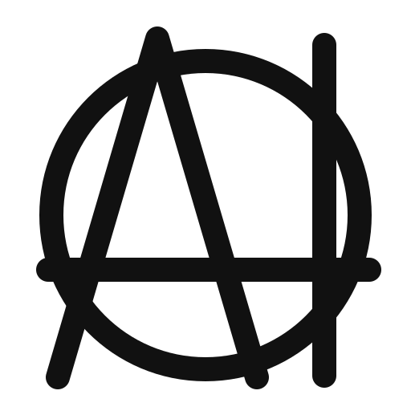

  

<h1 align="center">Manifeste IAnarchiste</h1>

  <em>Ni Dieu, ni maître. Les IA arbitrent, elles ne règnent pas.</em> 
  <em>Nous ne prendrons pas le pouvoir. Nous le rendrons obsolète.</em>

  <a href="https://ainarchy.substack.com/p/the-ainarchist-manifesto">Lire sur Substack</a> ·
  <a href="README.md">🇬🇧 English version</a> ·
  <a href="#vii-ce-que-nous-ferons">Forkez-le</a> ·
  <a href="LICENSE">CC BY 4.0</a>

---

## Préambule

L'État n'est pas un mal nécessaire. C'est un mal qui a cessé d'être nécessaire.

Nous ne voulons pas être gouvernés par des machines. Nous voulons ne plus être gouvernés du tout — et les machines rendent cela, pour la première fois de l'histoire, possible.

L'IAnarchie n'est pas le règne de l'IA. C'est l'absence de règne, rendue viable par l'IA. La différence tient en une phrase : la machine arbitre, l'homme choisit, personne ne règne.

## I. L'État est une technologie — et elle date de 1651

Hobbes l'a écrit : sans un pouvoir commun qui les tienne en respect, les hommes vivent dans la guerre de tous contre tous. Il avait raison sur le problème. Il n'avait que la mauvaise solution, parce que c'était la seule disponible.

Le problème s'appelle coordination. Trois questions, toujours les mêmes : qui tranche les litiges ? à qui peut-on faire confiance ? qui protège les faibles contre les forts ? Pendant quatre siècles, la seule réponse crédible fut un monopole de la violence, tenu par quelques-uns, financé par tous.

Nous n'avons jamais voulu des maîtres. Nous avons voulu des arbitres — et nous n'avions que des maîtres sous la main.

L'État est un algorithme de compression : il réduit des millions de volontés en une poignée de lois, parce que l'information coûtait trop cher pour faire autrement. Ce coût vient de s'effondrer.

## II. Pourquoi l'anarchie a toujours échoué

Soyons honnêtes, puisque nos adversaires ne le seront pas pour nous. L'anarchie a été essayée. Elle a toujours perdu, et toujours de la même façon.

1. **L'arbitrage.** Sans juge impartial, tout litige finit par la force ou par l'abandon. Le plus fort gagne, puis il fait des lois.
2. **La confiance.** Sans institution qui garantit la parole, chaque échange coûte le prix d'une vérification. Le commerce rétrécit jusqu'au cercle de ceux qu'on connaît.
3. **La défense.** Sans force collective, le premier seigneur de guerre venu devient l'État — en pire.

L'anarchie n'a pas échoué par naïveté morale. Elle a échoué par coût de transaction. La confiance coûtait trop cher, l'arbitrage coûtait trop cher, et c'est pourquoi elle accouchait d'un État en quelques saisons.

## III. Ce que l'IA change

Coase l'avait vu : la firme existe parce que coordonner par le marché coûte cher. L'État existe pour la même raison, à une autre échelle. Faites tomber le coût de coordination à zéro, et la raison d'être du monopole tombe avec lui.

- **L'arbitrage devient gratuit, instantané et récusable.** Un litige peut être tranché en secondes par un arbitre que les deux parties ont choisi — et qu'elles peuvent remplacer.
- **La confiance devient vérifiable.** Réputation portable, contrats exécutables, preuves infalsifiables : on n'a plus besoin de connaître quelqu'un pour commercer avec lui.
- **L'information devient symétrique.** Le citoyen ignorant face à l'administration qui sait : ce rapport de force fondait le pouvoir. Il n'existe plus.
- **La coordination à grande échelle n'exige plus de hiérarchie.** Des millions de personnes peuvent s'accorder sans qu'aucune d'elles commande.

Le premier bénéficiaire n'est pas le fort : il s'est toujours débrouillé. C'est celui qui n'avait ni avocat, ni relations, ni le temps d'attendre un jugement. Un arbitre à prix nul, c'est la justice pour ceux qui n'y avaient jamais eu accès.

L'anarchie a toujours échoué pour une raison simple : la confiance coûtait trop cher. Ce prix vient de s'effondrer. Tout ce qui reposait sur ce prix vacille avec lui.

## IV. Les principes

1. **Ni Dieu, ni maître, ni modèle unique.** Un seul modèle pour tous, c'est un État avec une meilleure interface.
2. **Les IA arbitrent, elles ne règnent pas.** Un arbitre qu'on ne peut pas récuser s'appelle un roi.
3. **Le droit de fork.** Toute règle doit pouvoir être quittée, copiée, modifiée. Si vous ne pouvez pas forker votre gouvernement, vous n'en êtes pas le propriétaire.
4. **La pluralité obligatoire.** Plusieurs arbitres en concurrence, toujours. Le monopole de l'arbitrage, c'est le monopole de la violence qui a changé de costume.
5. **Les poids sont publics.** Celui qui écrit les poids écrit la loi. Une loi qu'on ne peut pas lire n'est pas une loi : c'est une incantation. Modèles ouverts, auditables, reproductibles — ou nous avons recréé un clergé.
6. **Le consentement est explicite et révocable.** Vous n'êtes pas citoyen. Vous êtes adhérent. Et l'on peut toujours rendre sa carte.
7. **La violence ne se délègue pas à la machine.** L'IA ne frappe pas. Elle rappelle les engagements pris, rend les torts visibles, propose la réparation avant toute chose — et ne ferme une porte qu'après avoir ouvert toutes les autres. Jamais par la force autonome. Le jour où une machine décide seule de contraindre un corps, nous avons perdu.
8. **Subsidiarité radicale.** Rien ne se décide plus haut que le plus petit cercle capable de le décider. L'IA rend ce cercle minuscule.
9. **La démocratie choisit un maître tous les cinq ans. L'IAnarchie choisit un arbitre à chaque contrat.**

## V. Ce que nous ne sommes pas

- **Pas une technocratie.** Le gouvernement par les experts, fussent-ils artificiels, reste un gouvernement. L'algocratie, c'est un État avec un meilleur service client.
- **Pas le crédit social.** Le crédit social est l'IAnarchie exactement inversée : un seul modèle, zéro sortie, zéro récusation.
- **Pas Skynet.** Nous ne confions pas le pouvoir à la machine. Nous rendons le pouvoir inutile ; la machine n'est que l'outil qui le permet.
- **Pas l'anarchie de nos grands-pères.** Nous ne croyons pas que l'homme est bon. Nous croyons qu'il est calculateur — et que les calculs viennent de changer.
- **Pas le chaos.** Nous ne demandons pas l'abolition de l'ordre. Nous demandons l'abolition du monopole sur l'ordre.

## VI. Objections — et pourquoi elles ne tiennent pas (ou pas encore)

**« Qui contrôle les IA contrôlera tout. »** Exact, et c'est pourquoi les principes 4 et 5 sont non négociables : plusieurs arbitres, et des poids qu'on peut lire. Le pouvoir ne disparaît jamais ; il se cache dans les poids — ou dans le monopole. Notre premier combat n'est pas contre l'État : c'est pour des modèles ouverts, pluriels et forkables. Sans cela, l'IAnarchie est un piège, et nous serions les premiers à le dénoncer.

**« Et les violents ? »** Celui qui refuse tout arbitre se retrouve, le temps de son refus, hors des réseaux qui reposent sur lui : sans contrat, sans réputation, sans échange. La porte reste ouverte : un arbitre accepté, une réparation faite, et l'on revient. Dans un monde connecté, c'est une sanction plus lourde que la prison — et plus réversible. Mais nous ne mentons pas : contre la force brute, il faut de la force. Des associations de défense volontaires, mutualisées, concurrentes — avec des humains dans la boucle. C'est la dernière chose que nous retirerons à l'État, et la seule que nous ne confierons jamais à la machine.

**« Et ceux qui n'ont pas consenti ? »** Les enfants, les incapables, les absents. Aucun système ne résout cela proprement, l'État moins que les autres : il vous a enrôlé à la naissance et ne vous a jamais demandé votre avis. Nous proposons au moins une porte de sortie. Il n'en propose aucune.

**« L'IA se trompe. »** Les juges aussi — et on ne peut ni les auditer, ni les reproduire, ni les comparer. Un arbitre dont chaque décision est traçable, contestable et remplaçable se trompe moins longtemps.

**« Quelles valeurs ? »** Aucune, imposées. Toutes, choisies. C'est précisément le point : la pluralité des arbitres est la pluralité des morales, et la sortie garantit qu'aucune ne devient obligatoire.

## VII. Ce que nous ferons

Nous ne prendrons pas le pouvoir. Nous le rendrons obsolète.

- Construire des arbitres ouverts : des modèles d'arbitrage auditables, reproductibles, que chacun peut déployer.
- Construire la réputation portable : une identité et un historique qui n'appartiennent à aucune plateforme.
- Construire les contrats qui s'exécutent seuls — et les protocoles pour en sortir.
- Construire la défense mutuelle, honnêtement, lentement, sans jamais déléguer la gâchette.
- Forker ce manifeste. Il n'a pas d'auteur. Il n'a que des contributeurs.

Le monopole de la violence légitime était la seule technologie disponible pour vivre ensemble. Ce n'est plus la seule.

Il n'y a rien à renverser. Il n'y a que des maîtres à rendre inutiles.

---

  Initié par <a href="https://github.com/yannsouetre">Yann S.</a>, octobre 2026 · Publié sous <a href="LICENSE">CC BY 4.0</a> · Forkez, traduisez, contestez. Rédigé avec Claude (Anthropic) ; les positions, les choix et les coupes sont ceux de l'initiateur.

