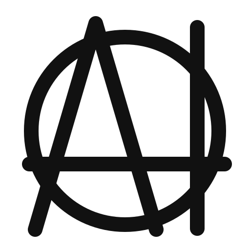

  

<h1 align="center">The AInarchist Manifesto</h1>

  <em>No gods, no masters. The AIs arbitrate; they do not reign.</em> 
  <em>We will not seize power. We will make it obsolete.</em>

  <a href="https://ainarchy.substack.com/p/the-ainarchist-manifesto">Read on Substack</a> ·
  <a href="MANIFESTE.md">🇫🇷 Version française</a> ·
  <a href="#vii-what-we-will-do">Fork it</a> ·
  <a href="LICENSE">CC BY 4.0</a>

---

## Preamble

The state is not a necessary evil. It is an evil that has stopped being necessary.

We do not want to be ruled by machines. We want to stop being ruled at all — and for the first time in history, machines make that possible.

AInarchy is not the rule of AI. It is the absence of rule, made workable by AI. The whole difference fits in one sentence: the machine arbitrates, the human chooses, nobody reigns.

## I. The state is a technology — and it shipped in 1651

Hobbes wrote it down: without a common power to keep them in awe, men live in a war of all against all. He was right about the problem. He only had the wrong solution, because it was the only one available.

The problem is called coordination. Three questions, always the same: who settles disputes? whom can you trust? who protects the weak from the strong? For four centuries the only credible answer was a monopoly on violence, held by a few and paid for by everyone.

We never wanted masters. We wanted arbiters — and masters were all we had in stock.

The state is a compression algorithm: it squeezes millions of wills into a handful of laws, because information was too expensive to do otherwise. That cost just collapsed.

## II. Why anarchy always failed

Let us be honest, since our opponents will not be honest on our behalf. Anarchy has been tried. It has always lost, and always the same way.

1. **Arbitration.** Without an impartial judge, every dispute ends in force or surrender. The strongest wins, then writes the laws.
2. **Trust.** Without an institution that backs a promise, every exchange costs the price of a verification. Trade shrinks to the circle of people you already know.
3. **Defense.** Without collective force, the first warlord to show up becomes the state — a worse one.

Anarchy did not fail out of moral naivety. It failed on transaction costs. Trust was too expensive, arbitration was too expensive, and so it gave birth to a state within a few seasons.

## III. What AI changes

Coase saw it: firms exist because coordinating through the market is costly. The state exists for the same reason, at a larger scale. Drive the cost of coordination to zero, and the reason for the monopoly falls with it.

- **Arbitration becomes free, instant and dismissible.** A dispute can be settled in seconds by an arbiter both parties chose — and can replace.
- **Trust becomes verifiable.** Portable reputation, self-executing contracts, tamper-proof evidence: you no longer need to know someone to trade with them.
- **Information becomes symmetric.** The ignorant citizen facing the all-knowing administration: that imbalance was the foundation of power. It is gone.
- **Large-scale coordination no longer requires hierarchy.** Millions of people can agree without any of them giving orders.

The first to benefit is not the strong; the strong always managed. It is the person who had no lawyer, no connections and no time to wait for a verdict. An arbiter at zero cost is justice for those who never had access to it.

Anarchy always failed for one simple reason: trust was too expensive. That price just collapsed. Everything that rested on that price is wobbling with it.

## IV. Principles

1. **No gods, no masters, no single model.** One model for everyone is a state with a better interface.
2. **AIs arbitrate; they do not rule.** An arbiter you cannot dismiss is called a king.
3. **The right to fork.** Every rule must be leavable, copyable, editable. If you can't fork your government, you don't own it.
4. **Mandatory plurality.** Several competing arbiters, always. A monopoly on arbitration is the monopoly on violence in a new suit.
5. **The weights are public.** Whoever writes the weights writes the law. A law you cannot read is not a law: it is a spell. Open, auditable, reproducible models — or we have rebuilt a priesthood.
6. **Consent is explicit and revocable.** You are not a citizen. You are a member. And you can always hand back your card.
7. **Violence is never delegated to the machine.** AI does not strike. It recalls the commitments made, makes the harm visible, offers repair before anything else — and closes a door only after opening every other one. Never autonomous force. The day a machine decides on its own to constrain a body, we have lost.
8. **Radical subsidiarity.** Nothing is decided above the smallest circle able to decide it. AI makes that circle tiny.
9. **Democracy picks a master every five years. AInarchy picks an arbiter with every contract.**

## V. What we are not

- **Not a technocracy.** Rule by experts, artificial or not, is still rule. Algocracy is just a state with better customer service.
- **Not social credit.** Social credit systems are AInarchy turned exactly inside out: one model, no exit, no appeal.
- **Not Skynet.** We do not hand power to the machine. We make power obsolete; the machine is merely the tool that allows it.
- **Not our grandfathers' anarchy.** We do not believe people are good. We believe they are calculating — and the calculation just changed.
- **Not chaos.** We do not ask for the abolition of order. We ask for the abolition of the monopoly on order.

## VI. Objections — and why they fail (or don't, yet)

**"Whoever controls the AIs controls everything."** Correct, which is why principles 4 and 5 are non-negotiable: several arbiters, and weights you can read. Power never disappears; it hides in the weights — or in the monopoly. Our first fight is not against the state: it is for open, plural, forkable models. Without them, AInarchy is a trap, and we would be the first to say so.

**"What about the violent?"** Whoever refuses every arbiter stands, for as long as the refusal lasts, outside the networks that rest on it: no contracts, no reputation, no trade. The door stays open: accept an arbiter, repair the harm, and you are back. In a connected world that is a heavier sentence than prison — and a more reversible one. But we will not lie: against brute force, you need force. Voluntary, mutualized, competing defense associations — with humans in the loop. It is the last thing we will take from the state, and the only thing we will never hand to the machine.

**"What about those who never consented?"** Children, the incapable, the absent. No system solves this cleanly, the state least of all: it enrolled you at birth and never asked. We at least offer an exit. It offers none.

**"AI makes mistakes."** So do judges — and you can neither audit them, nor reproduce them, nor compare them. An arbiter whose every decision is traceable, contestable and replaceable stays wrong for less time.

**"Whose values?"** None, imposed. All, chosen. That is precisely the point: a plurality of arbiters is a plurality of moralities, and exit guarantees that none of them becomes mandatory.

## VII. What we will do

We will not seize power. We will make it obsolete.

- Build open arbiters: auditable, reproducible arbitration models anyone can deploy.
- Build portable reputation: an identity and a track record that belong to no platform.
- Build self-executing contracts — and the protocols to walk away from them.
- Build mutual defense, honestly, slowly, without ever delegating the trigger.
- Fork this manifesto. It has no author. It only has contributors.

The monopoly on legitimate violence was the only technology available for living together. It is no longer the only one.

There is nothing to overthrow. There are only masters to make unnecessary.

---

  Initiated by <a href="https://github.com/yannsouetre">Yann S.</a>, October 2026 · Released under <a href="LICENSE">CC BY 4.0</a> · Fork, translate, argue. Written with Claude (Anthropic); the positions, choices and cuts are the initiator's own.

